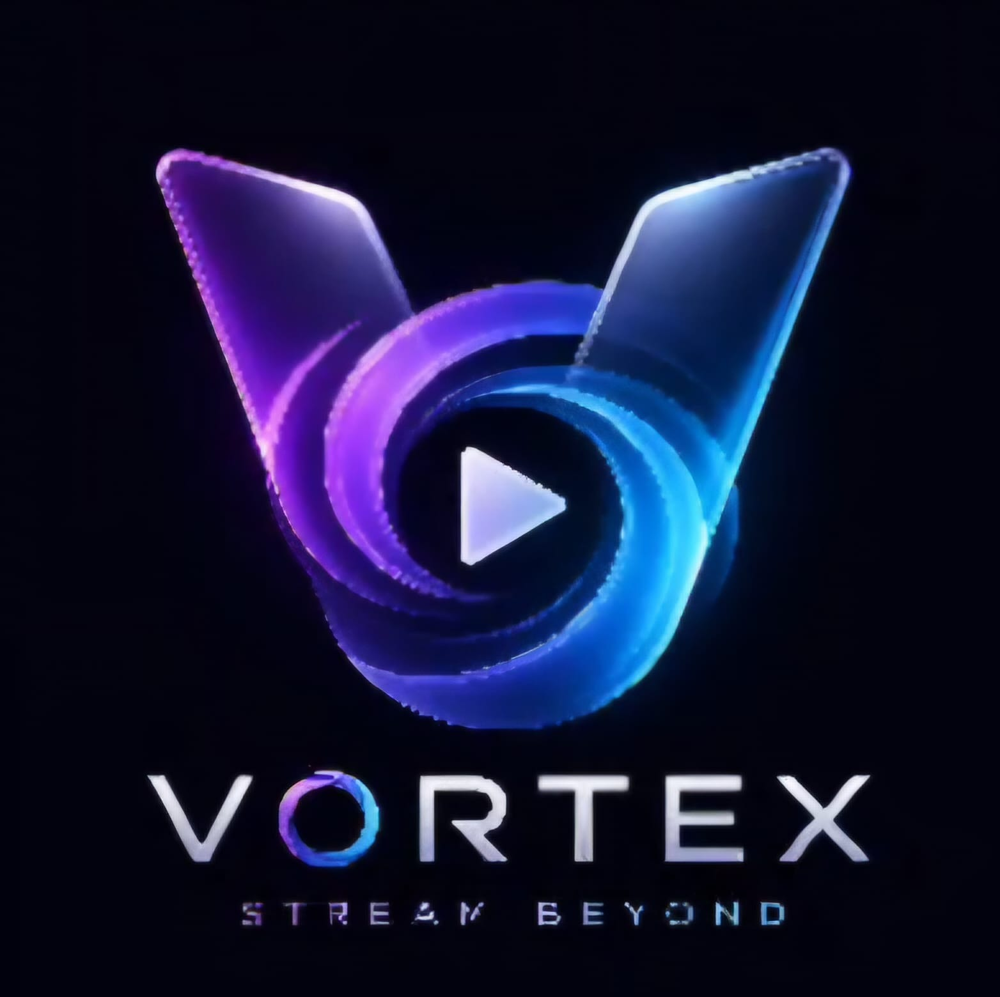

<div align="center">

  

  <p>
    <b>Vortex — Stream Beyond.</b>
    <br />
    Movies, TV shows and anime on your phone, with artwork, ratings, trailers and your place saved on every screen.
  </p>

</div>

## What's inside

- **Built-in Vortex source.** Home rows, search, discover and the details pages all come from the Vortex API
  (`api.watchvortex.me`), a TMDB proxy. No add-ons to install and no API keys to enter.
- **Vortex rows:** Trending, Popular Movies, Popular TV Shows, Anime, Bollywood, Hollywood, Cartoons, Drama,
  Now Playing and Top Rated, with genre filters and paging.
- **Seven Vortex servers.** Every title and episode lists Server 1 to Server 7. They play in the Vortex embed
  player, where you can switch servers without leaving playback.
- **Vortex Shield.** The embed player drops ad and tracker requests, refuses pop-ups and blocks redirects away
  from the player.
- **Library, Continue Watching, Trakt/Simkl tracking, MDBList ratings and downloads.**

## Code map (Vortex integration)

| Area | Where |
| --- | --- |
| Vortex API client (TMDB proxy) | `composeApp/src/commonMain/kotlin/com/nuvio/app/features/vortex/VortexApi.kt` |
| Built-in source (catalogs, details, streams) | `.../features/vortex/VortexBuiltinAddon.kt` |
| Server list and embed URLs | `.../features/vortex/VortexServers.kt` |
| Ad and redirect shield | `.../features/vortex/VortexAdShield.kt` |
| Embed player UI | `.../features/vortex/VortexEmbedPlayer.kt` (+ `VortexEmbedWebView.android.kt` / `.ios.kt`) |

## Build from source

### Android

Android development requires Android Studio and the Android SDK.

```bash
./gradlew :androidApp:assembleFullDebug
```

### iOS

iOS development requires macOS and Xcode.

```bash
env NUVIO_IOS_DISTRIBUTION=full xcodebuild \
  -project iosApp/iosApp.xcodeproj \
  -scheme iosApp \
  -configuration Debug \
  -sdk iphonesimulator \
  -derivedDataPath build/ios-derived-full-simulator \
  CODE_SIGNING_ALLOWED=NO \
  build
```

The shared app is built with Kotlin Multiplatform and Compose Multiplatform.

## License

Vortex is built on [Nuvio Mobile](https://github.com/NuvioMedia/NuvioMobile) and is distributed under the
[GNU General Public License v3.0](./LICENSE).
